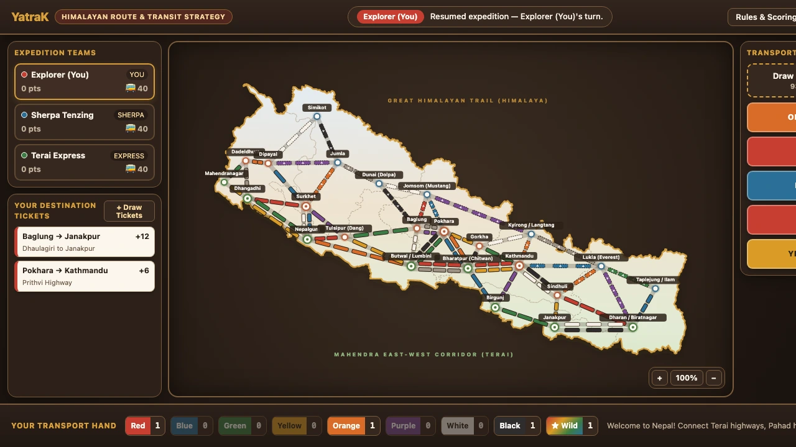

# Ticket2Ride_NPL — Ticket to Ride: Nepal Edition

An interactive strategy board game set across the geography of Nepal — from the fast **Mahendra East–West Highway** in the southern **Terai** plains, through the winding **Pahad** mid-hills (*Kathmandu, Pokhara, Surkhet, Baglung*), up to the rugged **Himalayan Mountain Passes** (*Simikot, Jumla, Dolpa, Jomsom, Langtang, Lukla/Everest, Taplejung*).



---

## Features & Nepal Map Mechanics

- **24 Nepali Cities & 56 Transport Routes**:
  - **Terai Corridor**: High-speed, long flat routes connecting *Mahendranagar, Dhangadhi, Nepalgunj, Butwal, Bharatpur, Birgunj, Janakpur, and Dharan/Biratnagar*.
  - **Pahad Mid-Hills**: Strategic hub bottlenecks through *Dadeldhura, Surkhet, Pokhara, Gorkha, Kathmandu, and Sindhuli*.
  - **🏔️ Himalayan Mountain Passes**: High-altitude routes (*Simikot, Jumla, Dolpa, Jomsom, Langtang, Lukla, Taplejung*) award **+2 bonus points** upon claiming, but trigger a 1-card weather check from the transport deck (similar to Europe Tunnels).
- **18 Authentic Destination Tickets**: Including the *Mahendra East-West Highway (21 pts)*, *Great Himalayan Trail (22 pts)*, *Prithvi Highway*, *BP Koirala Highway*, and *Karnali River Corridor*.
- **Graph Algorithms (`src/graph.ts`)**:
  - **BFS / Connected Components**: Automatically verifies Destination Ticket completion and highlights your connected city network on hover.
  - **Backtracking DFS**: Computes the **Longest Continuous Trail** (+10 bonus points at game end) and highlights the winning trail in gold.
  - **Dijkstra Shortest Path**: Powers the AI opponents' route planning.
- **3 AI Bot Personalities**:
  - **Sherpa Tenzing (`sherpa`)**: Prioritizes high-altitude Himalayan Mountain Passes and hoards Wild cards.
  - **Terai Express (`express`)**: Races to build long 3–5 segment highway corridors.
  - **Mugling Blocker (`blocker`)**: Targets critical hub-to-hub choke points (*Pokhara, Bharatpur, Kathmandu*).

---

## Reactive Architecture with `statebinderk`

Built with **pure TypeScript + SVG + `statebinderk`** (zero virtual-DOM overhead). All board elements have deterministic DOM IDs bound directly to reactive state variables in `src/binder.ts`:

- `StateVarList<RouteOwnershipBinding>` & `StyleVarList<string>`: Binds all 56 SVG route groups (`#route-0` .. `#route-55`) for instant ownership coloring, token badges, and longest-trail glow.
- `MultiStateVar<TurnBannerBinding>`: Simultaneously updates the active turn badge (`#turn-player-badge`), turn status prompt (`#turn-status-text`), and active player card highlight (`#player-cards-row`).
- `StateVarList<number>` & `StateVarList<CardColor | null>`: Binds player scores (`#player-score-0`..`3`), carriage stocks (`#player-carriages-0`..`3`), hand card counts (`#hand-count-red`..`locomotive`), and the 5 face-up market slots (`#market-slot-0`..`4`).

---

## Project Structure

```text
Ticket2Ride_NPL/
├── index.html          # App entry point
├── package.json        # Vite + TypeScript + statebinderk
└── src/
    ├── types.ts        # Core types (NepalCity, NepalRoute, DestinationTicket, PlayerState)
    ├── nepalMapData.ts # 24 Nepal cities, 56 routes, and 18 Destination Tickets
    ├── binder.ts       # Reactive statebinderk bindings for SVG routes, HUD, and cards
    ├── graph.ts        # BFS connectivity, DFS Longest Continuous Trail, Dijkstra AI planner
    ├── gameEngine.ts   # Turn state machine, market rules, Mountain Pass checks, AI turns
    ├── boardView.ts    # SVG Nepal topography & route renderer, modals, and tooltips
    ├── main.ts         # Session bootstrap and event wiring
    └── style.css       # Warm Himalayan parchment & terracotta styling
```

---

## Getting Started

```bash
git clone https://github.com/mk314k/Ticket2Ride_NPL.git
cd Ticket2Ride_NPL
npm install
npm run dev
```

## License

MIT License — see [LICENSE](./LICENSE) for details.
